# 화면으로 보는 날도와줘

[README로 돌아가기](../README.md) · [설치 안내](INSTALL.md)

2026년 10월 24일까지 만든 프리뷰 중 기능별 최신 화면을 모았습니다. 예시 일정·대화·일기가 들어 있는 정적 프리뷰로, 타이핑과 탄성 모션은 보이지 않습니다.

## 데스크톱 펫과 대화

펫을 클릭하면 서랍이 열려요. 대화에서 AI가 만든 일정은 답장 아래의 상세 보기 카드로 바로 열 수 있습니다.

  
  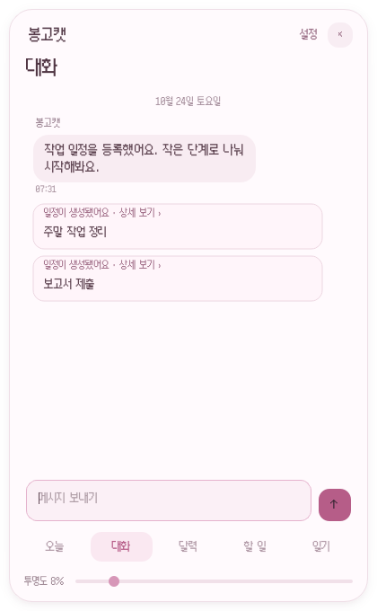

## 일정과 작은 단계

월간 달력에서 날짜를 고르거나 주간 시간표로 한 주를 살펴보세요. 일정의 상세 화면에서는 작은 단계를 체크하고, 오늘 화면에서는 이전 미완료 항목을 확인할 수 있어요.

  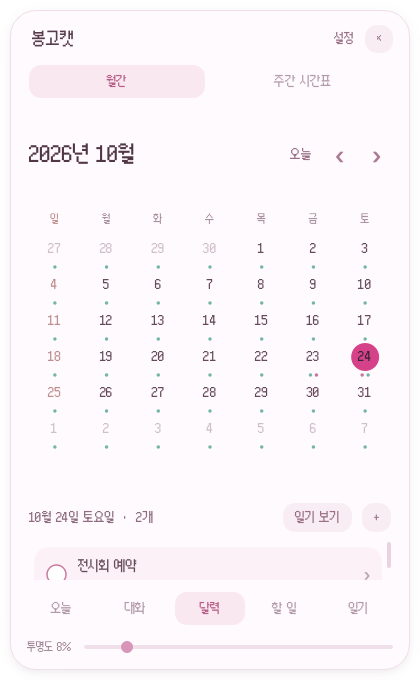
  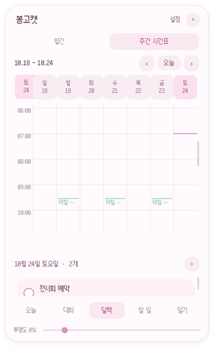
  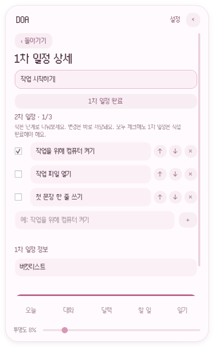
  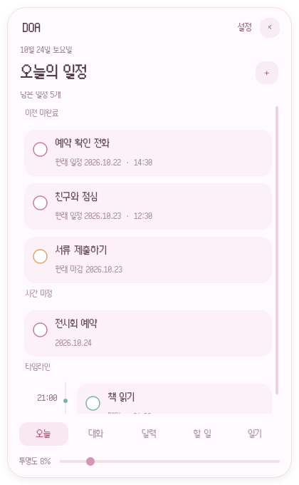

## 일기와 AI 초안

날씨·기분·태그를 붙여 하루를 기록해요. 그날 대화로 만든 AI 초안은 내용을 확인하고 적용할 수 있습니다.

  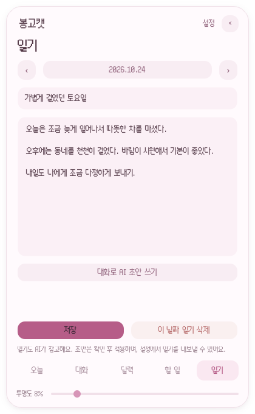
  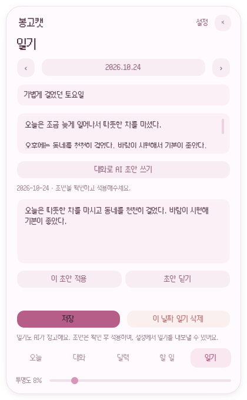

## 이모지와 스티커

이미지를 등록해 글 사이의 이모지나 단독 스티커로 보내요.

  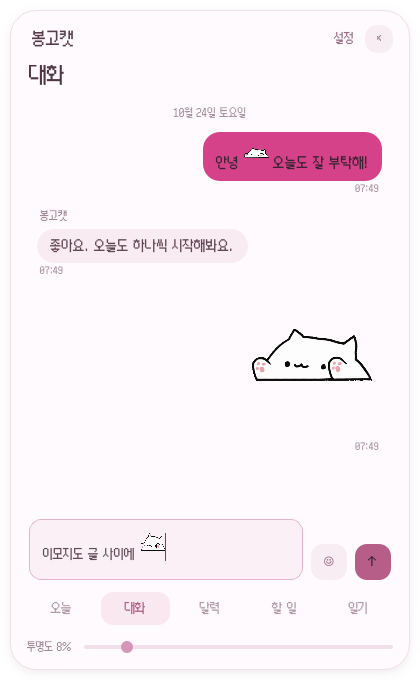
  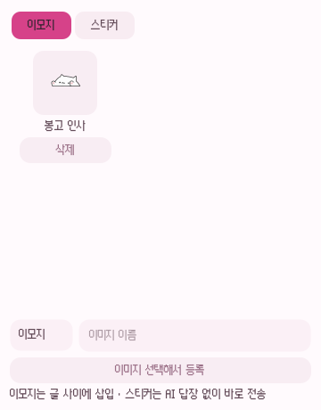

## 이름·이미지·테마 꾸미기

설정에서 이름, 테마색, 펫 이미지를 바꿀 수 있어요. 아래는 꾸미기 설정과 파란 테마 예시입니다.

  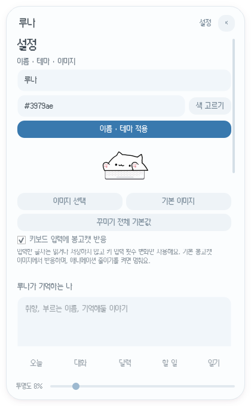
  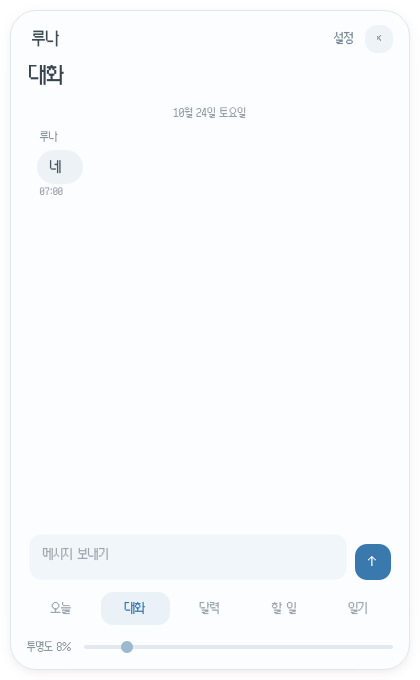

기본 봉고캣은 코드로 그린 키보드 위에 투명 PNG를 올려 표시해요. 타이핑 프레임이 바뀔 때 PNG만 변형하므로 키보드는 고정되어 있습니다. 다른 캐릭터도 꾸미기에서 정지·왼손 내림·오른손 내림 이미지 3장을 등록하면 키 입력과 AI 답장 중에 손 교대·탄성 모션이 적용됩니다. 같은 크기·위치의 투명 PNG를 권장하며, 이미지에 포함된 키보드는 함께 변형돼요. 손 이미지를 등록하지 않은 상태는 정지 이미지로 대신합니다. 정지 이미지를 바꾸거나 기본 이미지로 돌아가면 등록한 손 이미지는 초기화됩니다. 움직임 줄이기를 켜면 모션이 멈춰요.

## 아이폰·아이패드

맥의 모바일 접속을 켜면 같은 데이터를 모바일 브라우저에서도 사용할 수 있어요. 연결 방법은 [README의 모바일 안내](../README.md#아이폰--아이패드에서-쓰기-tailscale)를 참고하세요.

  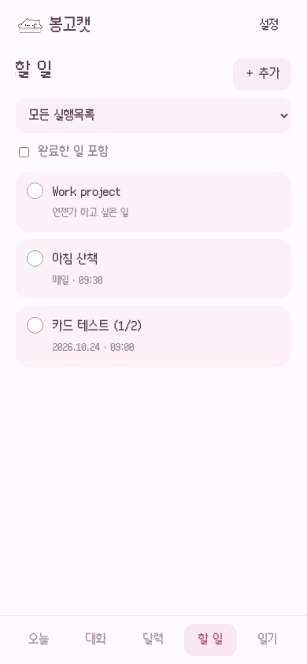
  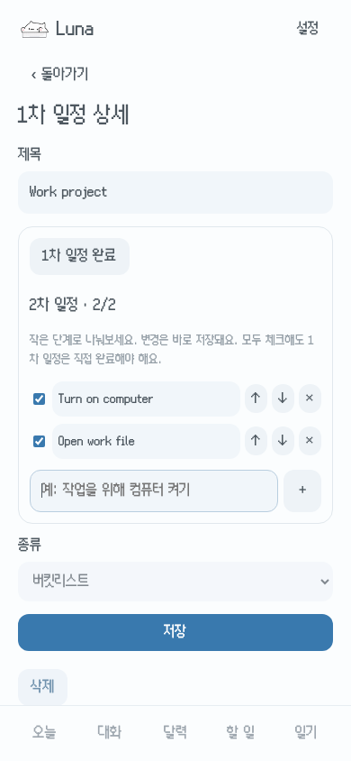
  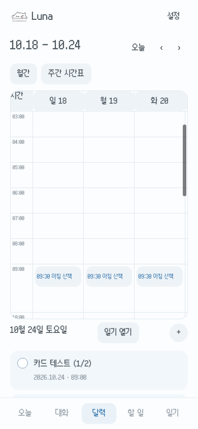
  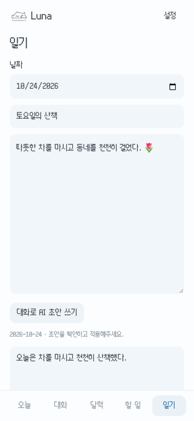

